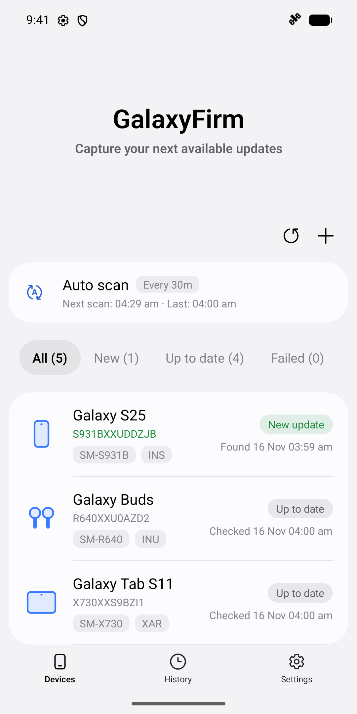
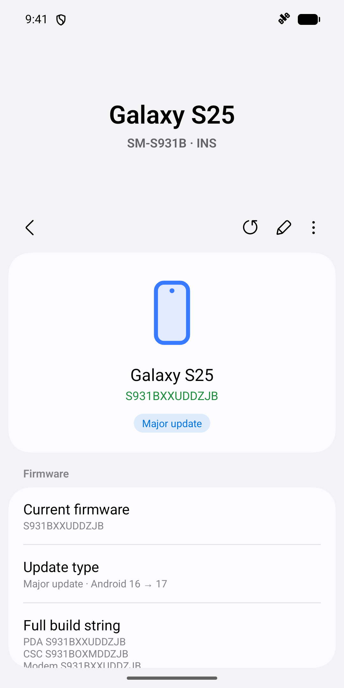
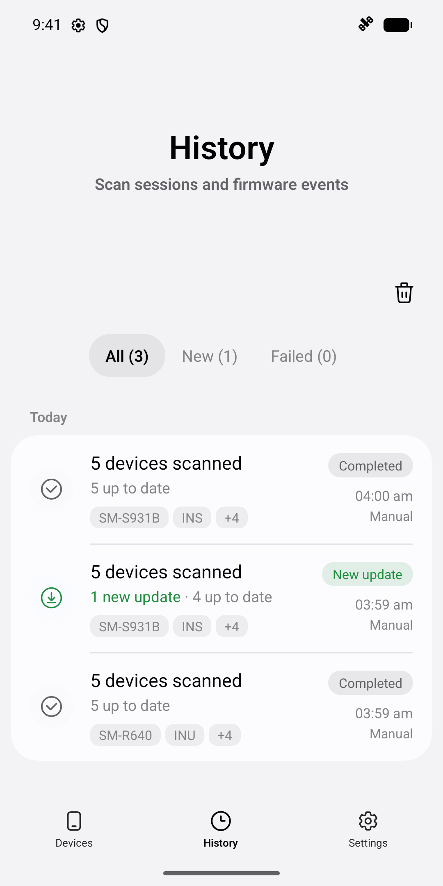
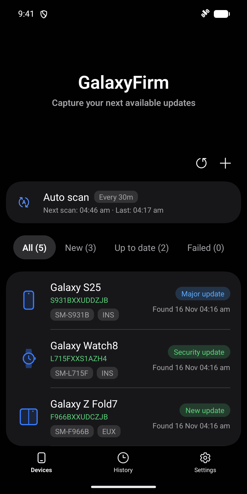

<div align="center">


# GalaxyFirm

**Get alerted the moment new firmware is released for your Galaxy phones, foldables, tablets, watches and buds.**

A native-looking One UI app built on Samsung's own SESL widget forks.

[Download the latest APK](https://github.com/RisenID/GalaxyFirm/releases/latest) · [Privacy policy](PRIVACY.md) · [Licence: GPL-2.0](LICENSE)

</div>

<p align="center">
  
  
  
  
</p>

> GalaxyFirm is an independent project. It is not affiliated with, endorsed by or sponsored by Samsung Electronics. Samsung and Galaxy are trademarks of Samsung Electronics Co., Ltd.

## Features

- **Track any Galaxy device** by model number (for example `SM-S931B`) and region / CSC code (for example `INS`, `EUX`, `XAA`). The device type (phone, foldable, tablet, watch, buds) is detected from the model number, and there is a picker of common region codes.
- **Know what's current.** Each device shows its latest build (PDA), the full `PDA/CSC/MODEM` build string, the Android version, the previous build and when it was last checked.
- **Instant alerts.** Background checks run every 10 minutes, 15 minutes, 30 minutes, 1 hour, 2 hours or 3 hours. You get a notification as soon as a newer build appears.
- **Coming soon.** Builds that are already on Samsung's servers but not yet rolling out are shown and announced before they arrive, and you are notified again when they go live.
- **Major or security?** Every update is labelled as a **Major update** (new Android or One UI version), a **Security update** (security-only maintenance release) or a regular **New update**.
- **Full scan history.** Every check is recorded with the number of devices scanned, new updates and failures. You can filter the list and open any session for per-device results.
- **One UI throughout.** The app uses a collapsing large title, rounded card lists, sub-tab filters, the One UI switch bar, the bottom tab bar, and light and dark themes.
- **Private.** There is no account, no analytics and no ads. Data never leaves the phone, except for the model and region codes sent to Samsung's firmware servers.
- **Backups.** You can export your device list to a JSON file and import it again later.

The app only tells you that new firmware exists. To install an update, use **Settings → Software update** on the device as usual.

## How it works

### Finding the latest firmware

The lookup is ported from [Bifrost](https://github.com/zacharee/Bifrost) and lives in [`FusClient.kt`](app/src/main/java/dev/risenid/galaxyfirm/data/net/FusClient.kt) and [`FirmwareClient.kt`](app/src/main/java/dev/risenid/galaxyfirm/data/net/FirmwareClient.kt).

Every check asks both of Samsung's sources at the same time:

1. **Public OTA list (`version.xml`).** `https://fota-cloud-dn.ospserver.net/firmware/{CSC}/{MODEL}/version.xml` is what phones poll for over-the-air updates. Its `<latest>` entry is the build you can actually install, shown as *Available firmware*.
   - If Samsung returns `AccessDenied`, the device is reported as *Model or region not found*.
   - If there is no `<latest>` entry, it is reported as *No firmware published*.
2. **FUS history.** The app asks Samsung's update service (`neofussvr.sslcs.cdngc.net`) for the model's full firmware history.
   - It first requests a nonce and decrypts it, then signs the request with the `FUS nonce=…, signature=…` authorisation header.
   - The `BINARY_INFO` entries are sorted by sequence, beta builds are dropped, and the newest entry is used. This also gives the Android version and release date.
   - New builds usually appear here days before they roll out over the air. When the FUS build is newer than the public one, it is shown as **Coming soon**.
   - If a region has no public list, the FUS build is used as the available firmware.
   - The same history fills in each device's details: the Android version, the previous build and the release date of the available build. Rows that would be empty are hidden.
   - Watches show their **Wear OS** version (for example *Wear OS 6 (Android 16)*, and *Wear OS 6 → Wear OS 7* for a major update). Buds have no OS version.
3. **Normalising the build string.** Build strings are normalised to `PDA/CSC/MODEM/PDA`, as Bifrost does. The PDA part (for example `S931BXXUDDZJB`) is the build that is tracked.

### Deciding "Up to date", "Coming soon" and "New update"

1. **When you add a device**, the current public build becomes its baseline, and the device shows **Up to date** (or **Coming soon** if FUS already has something newer).
2. **On every scan**, the public build is compared with the stored one by [`BuildVersion`](app/src/main/java/dev/risenid/galaxyfirm/data/net/BuildVersion.kt).
   - A device is marked **New update** only if the build is genuinely newer.
   - "Newer" is decided from the last five characters of the PDA, compared in this order: year, month, bootloader, major and build revision.
   - The year comparison handles the alphabet wrapping round.
   - An older or identical build is never reported, so a temporary fallback to the other server can't cause a false alert.
3. **When a new update is found**, it is classified by `BuildVersion.classify`:
   - **Major update** if the Android version went up, or the major-version character (4th from the end of the PDA, e.g. `D` in `S931BXXUDDZJB`) went up.
   - Otherwise **Security update** if the update-type character (6th from the end) is `S`, which Samsung uses for security-only builds such as `L715FXXS1AZH4`.
   - Otherwise a regular **New update**; `U` builds carry features and fixes as well as the security patch.
4. **The type is shown** on the device's badge, in an *Update type* row on its detail screen (e.g. *Major update · Android 16 → 17*), in the scan history and in the notification title. The old build moves to *Previous firmware* and the device is listed first.
5. **Coming soon.** When a newer build first shows up in FUS but not on the public list, the device gets a **Coming soon** badge and an *Upcoming firmware* section, classified the same way, and you get a *Major update coming soon* / *Security update coming soon* / *Update coming soon* notification.
6. **When it reaches the public list**, it becomes a normal **New update** with the usual *update available* notification, and the coming-soon notification is removed.
7. **The device stays flagged until you tap *Mark as seen***, even if a later check fails.
8. **Failed lookups** (network errors, an unknown model or region) show as **Failed** with the reason, and are retried on the next scan.

### Background checks

- [`ScanScheduler`](app/src/main/java/dev/risenid/galaxyfirm/work/ScanWorker.kt) sets an exact `setExactAndAllowWhileIdle` alarm for the next check.
- When it fires, [`ScanAlarmReceiver`](app/src/main/java/dev/risenid/galaxyfirm/work/ScanAlarmReceiver.kt) queues a one-time WorkManager job (expedited on Android 12 and later) and books the following alarm.
- If *Alarms & reminders* is not allowed, the app falls back to a WorkManager periodic job. That job cannot run more often than every 15 minutes.
- [`BootReceiver`](app/src/main/java/dev/risenid/galaxyfirm/work/BootReceiver.kt) restores the schedule after a reboot, an app update, a time or time-zone change, or a change to the exact-alarm permission.
- Up to four devices are checked at a time. Only one scan can run at once.

### Permissions

| Permission | Used for |
| --- | --- |
| `INTERNET`, `ACCESS_NETWORK_STATE` | Querying Samsung's firmware servers |
| `POST_NOTIFICATIONS` | New firmware, coming-soon and failed-check alerts |
| `SCHEDULE_EXACT_ALARM` | On-time background checks |
| `RECEIVE_BOOT_COMPLETED` | Restoring the schedule after a restart |
| `WAKE_LOCK` | Used by WorkManager while a check runs |

- **First launch:** the app asks for notification permission, then opens the app's battery page so you can choose *Unrestricted*. On Samsung phones, background apps are otherwise put to sleep.
- **Later:** **Settings → Permissions** shows the state of each permission and links to the right system screen to fix it.

## Install

Download `galaxyfirm-v*.apk` from [Releases](https://github.com/RisenID/GalaxyFirm/releases) and install it.

- **Requirements:** Android 8.0 (API 26) or later. It works on any Android phone, but the look is designed for Samsung One UI.
- **Application ID:** `dev.risenid.galaxyfirm`.

## Building from source

### Requirements

- **JDK 25.** The One UI libraries compile to Java 24 bytecode.
  - The project asks Gradle for a JDK 25 toolchain through [`gradle/gradle-daemon-jvm.properties`](gradle/gradle-daemon-jvm.properties).
  - If Gradle can't find one, add `org.gradle.java.installations.paths=/path/to/jdk-25` to `~/.gradle/gradle.properties`.
- **Android SDK** with platform `android-37`. Set `sdk.dir` in `local.properties`, or set `ANDROID_HOME`.
- **Git and Bash**, to build the One UI libraries.

### 1. Build the One UI libraries

The app uses tribalfs' SESL forks of AndroidX and Material Components, plus the `oneui-design` component library.

- **Why build them:** the published packages live on GitHub Packages, which needs a token even for public packages, so this project builds them from source instead.
- **Version:** it uses the latest SESL 9 (One UI 9) base libraries. `oneui-design` has not published a One UI 9 release yet, so its One UI 8 design layer is recompiled against SESL 9.

```bash
JAVA_HOME=/path/to/jdk-25 ./oneui-libs/build.sh
```

[`oneui-libs/build.sh`](oneui-libs/build.sh) does the following:

1. Checks out each library at a pinned commit into `.oneui-src/`. This folder is git-ignored.
2. Applies the patches in [`oneui-libs/patches/`](oneui-libs/patches).
3. Publishes 18 artifacts to `~/.m2/repository`. To publish somewhere else, set `MAVEN_REPO`.

The first run takes around 15 to 25 minutes.

| Patch | What it changes |
| --- | --- |
| `sesl-androidx.patch` | Aligns internal SESL 9 version references; skips javadoc jars |
| `sesl-material-components-android.patch` | Aligns appcompat / recyclerview revisions; skips javadoc jars |
| `oneui-design.patch` | Moves the version catalog from SESL 8 to SESL 9 and the Java/Kotlin target to 24.<br>Fixes one moved string resource in `BottomTabLayout`.<br>Stubs `ImmersiveScrollHelper`, because SESL 9 removed the immersive-scroll API, so immersive app bars are disabled.<br>Drops `compileSdkMinor`. |

### 2. Build the app

```bash
./gradlew assembleDebug
./gradlew assembleRelease
./gradlew bundleRelease
```

Outputs:

| Command | Output |
| --- | --- |
| `assembleDebug` | `app/build/outputs/apk/debug/app-debug.apk` |
| `assembleRelease` | Minified with R8, under `app/build/outputs/apk/release/` |
| `bundleRelease` | Play Store bundle, under `app/build/outputs/bundle/release/` |

**Signing:** release builds are signed when these Gradle properties are set, for example in `~/.gradle/gradle.properties`. Otherwise they fall back to the debug key.

```properties
TESSERA_KEYSTORE=/path/to/keystore.jks
TESSERA_KEYSTORE_PASSWORD=…
# optional, when they differ from the keystore's first alias / store password
TESSERA_KEY_ALIAS=…
TESSERA_KEY_PASSWORD=…
```

### Project layout

```
app/src/main/java/dev/risenid/galaxyfirm/
├── data/
│   ├── net/          FusClient (FUS history), FirmwareClient (hybrid lookup), BuildVersion (build comparison)
│   ├── db/           Room database and DAOs
│   ├── model/        Device, ScanSession, ScanResult
│   ├── Repository    scans, update detection, backup/restore
│   └── Settings      preferences
├── work/             exact-alarm scheduler, scan worker, alarm and boot receivers
├── notify/           notification channels and alerts
├── ui/
│   ├── devices/      device list, add/edit, device detail
│   ├── history/      scan sessions and session detail
│   └── settings/     auto scan, notifications, permissions, appearance, app & data, about
└── util/             formatting and permission helpers
oneui-libs/           One UI library build script and patches
fastlane/metadata/    Play Store listing: text, icon, feature graphic, screenshots
```

### Stack

- Kotlin with XML views and ViewBinding.
- Coroutines and Flow.
- Room (via KSP).
- WorkManager.
- No networking or JSON libraries: `HttpURLConnection`, `XmlPullParser` and `org.json` are used directly.
- Built with:
  - Gradle 9.7.1
  - AGP 9.3.2
  - Kotlin 2.4.10
  - compileSdk / targetSdk 37
  - minSdk 26

## Play Store

Everything needed for the listing is in [`fastlane/metadata/android/en-US`](fastlane/metadata/android/en-US) in the standard fastlane layout. It can be uploaded with `fastlane supply` or entered by hand.

| Item | Content |
| --- | --- |
| Listing text | Title, short and full description |
| Icon | 512 × 512 |
| Feature graphic | 1024 × 500 |
| Screenshots | Six phone screenshots at 1080 × 2160 |
| Changelog | Release notes for versionCode 1 |

Answers for the Play Console forms:

- **Privacy policy URL:** `https://github.com/RisenID/GalaxyFirm/blob/main/PRIVACY.md`
- **Data safety:** no data collected and no data shared. The app sends only user-entered model and region codes, directly to Samsung, and these are not linked to the user. Data is encrypted in transit over HTTPS.
- **Ads:** none.
- **App access:** no login required.
- **Content rating:** utility, with no user-generated content.
- **Target audience:** 18+ (not designed for children).
- **Exact alarms:** the app uses `SCHEDULE_EXACT_ALARM`, which the user grants, not `USE_EXACT_ALARM`. No declaration is needed.

## Licence

GalaxyFirm is released under the [GNU General Public License v2.0](LICENSE).

The firmware lookup is derived from Bifrost, which is MIT-licensed. Its licence is reproduced in [`licenses/Bifrost-LICENSE.txt`](licenses/Bifrost-LICENSE.txt).

## Credits

This app would not exist without these projects:

| Project | Used for |
| --- | --- |
| [zacharee/Bifrost](https://github.com/zacharee/Bifrost) by Zachary Wander | The firmware lookup protocol: FUS history request, nonce handling, authorisation and `version.xml` fallback (MIT) |
| [tribalfs/oneui-design](https://github.com/tribalfs/oneui-design) | One UI components: `ToolbarLayout`, `BottomTabLayout`, `CardItemView`, rounded layouts, tips cards and more |
| [tribalfs/sesl-androidx](https://github.com/tribalfs/sesl-androidx) | SESL (Samsung Experience Support Library) forks of AndroidX: appcompat, recyclerview, preference, swiperefreshlayout and others |
| [tribalfs/sesl-material-components-android](https://github.com/tribalfs/sesl-material-components-android) | SESL fork of Material Components for Android |
| [OneUIProject/oneui-icons](https://github.com/OneUIProject/oneui-icons) | The `ic_oui_*` One UI icon set |
| [AndroidX Room](https://developer.android.com/jetpack/androidx/releases/room), [WorkManager](https://developer.android.com/jetpack/androidx/releases/work) | Local database and background work |
| [Kotlin coroutines](https://github.com/Kotlin/kotlinx.coroutines) | Concurrency |
